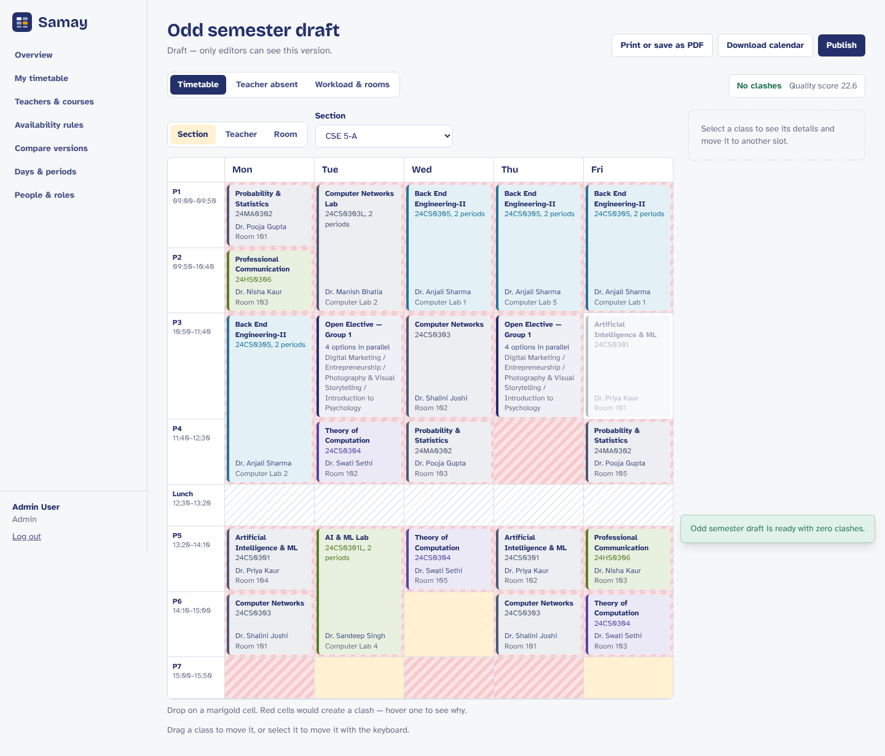
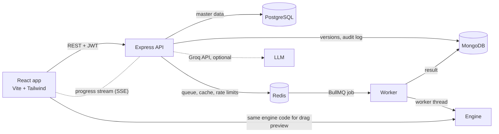

# Samay — AI-assisted timetable generator (NEP 2020)

Samay builds a clash-free weekly timetable for a college department in under a second, improves it for a few more seconds, and then lets the HOD fix anything by dragging it. While you drag a class, every cell in the grid shows whether dropping it there is fine or would clash.

Built for **Back End Engineering-II (24CS0305)** as a full-stack MERN project, plus PostgreSQL, Redis, Docker and CI.



## What it does

- **Generates timetables** from teachers, rooms, sections, courses and NEP elective baskets. Hard rules are never broken: no teacher, room or section is double-booked; labs run as double periods in lab rooms; rooms are big enough; teachers stay under daily and weekly limits.
- **Optimises quality** for things like fewer free periods between classes, teacher preferences, balanced days and fewer late classes. You choose how long it spends (5 s to 1 min) and watch it improve live.
- **Elective baskets (NEP 2020).** Several sections pick from options that all run at the same time, so no student ever has a clash whatever they choose.
- **Rules in plain English.** Type "Dr. Sharma can't teach before 10 on Mondays" and preview what it was understood as before saving. Uses Groq's free API if you add a key; otherwise a built-in parser handles common phrasings.
- **Drag-and-drop editing** with a live clash preview. The same rule code runs in the browser and on the server. A keyboard-friendly move form is available too.
- **Teacher absent?** It lists free, qualified colleagues for each of their classes that day.
- **Versions:** generate several, compare two side by side, and publish one.
- **Students and teachers** see the published timetable for their own section or schedule, as a grid on desktop and an agenda on phones. They can download a `.ics` file for Google Calendar or Outlook, or print to PDF.
- **Admin:** CSV bulk import with line-by-line errors, roles (admin, HOD, teacher, student), and an audit log.

## Quick start

### Option A: Docker (everything included)

```bash
docker compose up --build
docker compose exec api npm run seed     # loads the demo department
```

Open http://localhost:8080.

### Option B: run locally

You need Node 20+, PostgreSQL, MongoDB and Redis running locally. For hosted databases, see the free tiers below.

```bash
npm install
cp server/.env.example server/.env      # adjust the connection strings if needed
npm run seed -w server -- --reset       # creates tables + demo data
npm run dev:server                      # API on :4000 (also runs the generation worker)
npm run dev:client                      # web app on :5173
```

### Demo logins

Password for all: `Samay@2026`

| Email | Role | What they see |
|---|---|---|
| admin@samay.dev | Admin | Everything, including People & roles |
| hod@samay.dev | Head of department | Data, rules, generation, editing, publishing |
| faculty@samay.dev | Teacher | Their own published schedule |
| student@samay.dev | Student | Their section's published timetable |

The demo is one 5th-semester CSE department: 8 sections, 25 teachers, 10 rooms, 64 course assignments, 2 open-elective baskets and a few personal rules. All the names are made up.

## How the engine works

`engine/` is a dependency-free JavaScript package. It runs in two phases.

**1. Build a clash-free timetable** (`construct.js`). This is graph colouring where time slots are the colours.
- Always place the *most constrained* class next, the one with the fewest legal slots left (the DSatur heuristic).
- If a class has no legal slot, put it where it clashes with the fewest placed classes, take those out, and queue them again (an "ejection chain").
- Classes that keep getting kicked out become expensive to evict, which stops the search going round in circles.
- A class that can never fit is reported, and everything else is still scheduled.

**2. Improve it** (`anneal.js`) with simulated annealing.
- Try a small random change: move one class, or swap two classes of the same section. Changes that break a hard rule are rejected straight away.
- Changes that make it better are kept. Changes that make it worse are sometimes kept too, with a probability that shrinks as the "temperature" cools. That lets the search escape local minima early and settle down later.

**Checking** (`check.js`) is an independent checker that doesn't trust the solver. The tests use it to prove that every generated timetable is clean, and the server uses it to validate manual edits.

**Benchmark** (`npm run bench`), single CPU core, 5-second budget:

| Sections | Teachers | Rooms | Classes/week | Clash-free in | Quality score: start → after 5 s |
|---:|---:|---:|---:|---:|---:|
| 8 | 25 | 10 | 164 | 0.14 s | 190 → 13 |
| 16 | 50 | 19 | 328 | 0.09 s | 263 → 38 |
| 40 | 121 | 46 | 820 | 0.17 s | 585 → 96 |
| 80 | 238 | 91 | 1,640 | 0.54 s | 1,408 → 225 |

The same seed with the same input always gives the same timetable.

## Architecture



- **PostgreSQL** holds the master data: teachers, rooms, sections, courses, assignments, baskets, rules, users. It's relational data with many foreign keys, and imports need transactions.
- **MongoDB** holds generated versions. Each version is one self-contained document (*embedding*) with its events and a snapshot of the input, so an old version still makes sense after someone renames a room.
- **Redis** is the BullMQ job queue, the cache for timetables and dashboard stats (cache-aside with invalidation on every edit), and per-user rate limits.
- **Generation never blocks the API.** `POST /timetables` returns `202 Accepted`, a worker picks up the job and runs the engine in a worker thread, and the browser follows progress over Server-Sent Events.

## Syllabus coverage

| Syllabus topic | Where |
|---|---|
| HTML/CSS, responsive UI, Tailwind | `client/` (grid on desktop, agenda on phones, print stylesheet) |
| ES6, async/await, Fetch, Promises | `client/src/api.js` (streamed `fetch` reader for progress) |
| Node core: worker threads, streams, events, buffers, crypto | `server/src/services/engineRunner.js`, SSE in `routes/timetables.js`, CSV buffer upload, `utils/ids.js` |
| Express: routing, params, middleware, error handling | `server/src/routes/*`, `middleware/error.js` |
| Validation & sanitisation | zod schemas in every route, `middleware/validate.js` |
| JWT auth, bcrypt, protected routes, role-based access | `routes/auth.js`, `middleware/auth.js` |
| File upload (Multer) | `routes/import.js` (CSV import, all-or-nothing) |
| REST design, status codes | 201/202/204/400/401/403/404/409/422/429 used deliberately |
| MongoDB/Mongoose: schemas, virtuals, statics, indexes, TTL, aggregation, embedding | `models/Timetable.js`, `models/AuditLog.js`, `services/analytics.js` |
| SQL: schema, foreign keys, transactions, window functions, JSON aggregation | `db/migrations/001_init.sql`, `routes/crud.js`, `routes/offerings.js` |
| Search, filters, sorting, pagination | `routes/crud.js` + `DataPage.jsx` |
| React: hooks, custom hooks, useReducer, Context, Router, forms | `client/src/hooks.js`, `auth.jsx`, `TimetablePage.jsx` |
| Microservices idea, logging (Winston + Morgan) | separate worker process, `utils/logger.js` |
| Redis caching & strategies | `services/redis.js` (cache-aside, invalidation, rate limit) |
| Docker, Compose | `server/Dockerfile`, `client/Dockerfile`, `docker-compose.yml` |
| CI/CD (GitHub Actions) | `.github/workflows/ci.yml` (lint, tests on real Postgres/Mongo/Redis, build) |

## Suggested team split (4 people)

| Member | Owns |
|---|---|
| 1 | Scheduling engine: `engine/` (algorithm, scoring, checker, benchmark, tests) |
| 2 | Data and admin: Postgres schema, CRUD API, CSV import, auth and roles, Data page |
| 3 | Timetable UI: grid, drag-and-drop preview, compare, mobile agenda, print and `.ics` export |
| 4 | Generation pipeline and DevOps: queue/worker, SSE progress, analytics, rule parser (Groq), Docker, CI, deployment |

## Deploy for free

In production the API also serves the React app, so the whole project is **one Render web service on one URL**, with no CORS setup. It needs these free accounts (no card required):

| Part | Service | Free limit worth knowing |
|---|---|---|
| App + API | Render free web service | Sleeps after 15 min idle; first visit after that takes about a minute |
| Redis (queue, cache) | Render Key Value (created by `render.yaml`) | 25 MB, in memory, wiped on restart (fine: it only holds the queue and cache) |
| PostgreSQL | Neon | 1 GB per project, never expires |
| MongoDB | MongoDB Atlas free cluster | 512 MB |

Don't use Upstash for Redis here. An idle BullMQ worker keeps polling, which uses up Upstash's free command allowance.

1. **Neon:** create a project, then copy the connection string (`postgresql://…?sslmode=require`).
2. **Atlas:** create a free cluster and a database user. Under *Network Access* allow `0.0.0.0/0` (Render's free plan has no fixed IP). Copy the `mongodb+srv://…` string and add `/samay` before the `?`, e.g. `…mongodb.net/samay?retryWrites=true&w=majority`.
3. **Load the demo data** from your laptop into Neon: put the Neon string in `server/.env` as `DATABASE_URL`, then run `npm run seed -w server -- --reset`. Or skip this: the first account you register becomes the admin.
4. **Render:** push the repo to GitHub, then go to *New → Blueprint* and pick the repo. Paste `DATABASE_URL` and `MONGO_URL` when asked (`GROQ_API_KEY` is optional). `JWT_SECRET` is generated for you.
5. Open `https://<your-service>.onrender.com` and log in.

To stop it sleeping during demo week, point a free uptime pinger (e.g. cron-job.org) at `/health` every 10 minutes. One always-on service fits inside Render's 750 free hours a month.

Prefer Vercel for the frontend? Deploy `client/` there with `VITE_API_URL=https://<your-api>.onrender.com`, and set `CORS_ORIGIN` on the API to your Vercel URL.

## API overview

All routes are under `/api` and need `Authorization: Bearer <token>`, except `/auth/register` and `/auth/login`.

| Method & path | Who | Purpose |
|---|---|---|
| `POST /auth/register`, `POST /auth/login`, `GET /auth/me` | anyone | Accounts (the first account becomes admin) |
| `GET/POST/PATCH/DELETE /faculty`, `/rooms`, `/sections`, `/courses` | read: all, write: admin/HOD | Master data with `?q=&page=&limit=&sort=&order=` |
| `/offerings`, `/baskets` | same | Who teaches what; NEP elective baskets |
| `GET /import/:entity/template`, `POST /import/:entity` | admin/HOD | CSV templates and bulk import |
| `GET /constraints`, `POST /constraints/parse`, `POST /constraints`, `DELETE /constraints/:id` | admin/HOD | Availability rules (preview, then save) |
| `GET /timetables/preflight` | admin/HOD | Checks input data before generating |
| `POST /timetables` → 202 | admin/HOD | Queue a generation job |
| `GET /timetables/:id/progress` | admin/HOD | Live progress (Server-Sent Events) |
| `GET /timetables`, `GET /timetables/:id`, `GET /timetables/published` | editors; published for all | Versions |
| `PATCH /timetables/:id/events/:eventId` | admin/HOD | Move a class (`dryRun`, `force`); 409 on clash |
| `POST /timetables/:id/publish`, `GET /timetables/compare?a=&b=` | admin/HOD | Publish; compare two versions |
| `GET /timetables/:id/analytics`, `/substitutes`, `/ics` | editors; `.ics` for all | Workload, substitutes, calendar export |
| `GET /stats`, `GET /lookups`, `GET/PATCH /users`, `GET /audit` | varies | Dashboard, dropdowns, roles, audit log |

## Tests

```bash
npm test          # engine (14 tests) + API and unit tests (19 tests)
npm run lint
npm run bench
```

The API tests run against real PostgreSQL, MongoDB and Redis using separate test databases. They cover auth, roles, CRUD and pagination, all-or-nothing CSV import, generation through the queue, the progress stream, clash-refusing moves, publishing, analytics, substitutes, comparison, calendar export and the audit log.

## Project structure

```
engine/   scheduling engine (no dependencies): problem.js, construct.js, anneal.js, cost.js, check.js, move.js, substitutes.js
server/   Express API, worker, migrations, seed, tests
client/   React app (Vite + Tailwind)
docs/     screenshots
```
